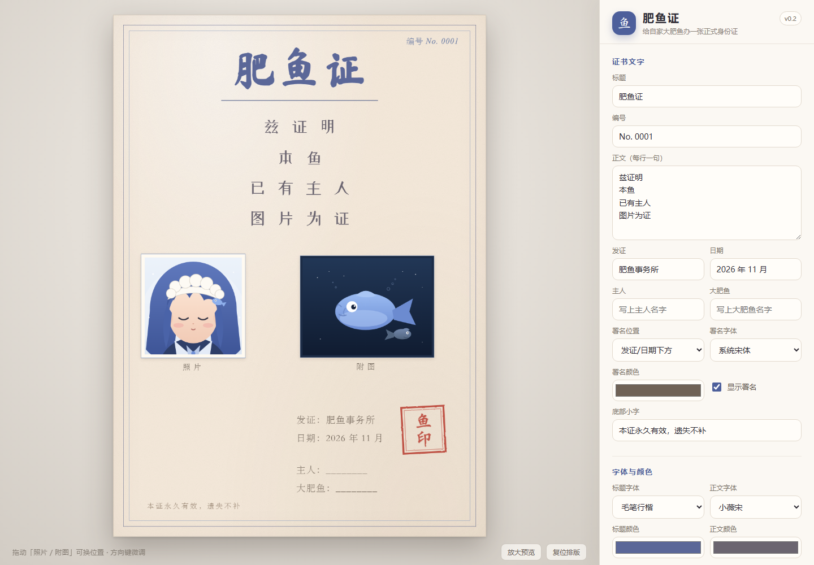

# 肥鱼证 · Feiyu Certificate

**在线使用：** <https://friade.github.io/feiyu-cert/>

给养大肥鱼的人一张正式的、可以长期留着的身份证明。  
填上名字、照片和鱼图，盖下「鱼印」，导出高清 PNG。

灵感来自 B 站视频 **BV1oyxC6HEvt**（UP：提仆兮袔，《忧郁肥鱼》系列第 10 集）。  
这是一个非官方同人项目，目前是 **v0.2 可发布版**，不包含 UP 的角色素材。



## v0.2 更新

- 照片 / 附图新增比例选择：1:1、4:3、3:4、1:1.5、1.5:1、1:2、2:1；高比例会自动收窄，避免压到发证区。
- 图片标签可单独开关、改文字；「附：图」的冒号已去掉。
- 新增署名区：主人 / 大肥鱼，可放在发证日期下方或左侧，支持独立字体、颜色、显隐。
- 发证默认改为「肥鱼事务所」。
- 字体选项去掉「（开源）」字样，界面更干净。
- 上传区下方增加「刷新会丢失图片」提示。
- 去掉滚轮缩放，只保留滑块，避免误触。

## 现在能做什么

- 1000 × 1400 的证书版式：双线蓝框、毛笔标题、四行正文、照片 / 附图双图位、发证信息、红色鱼印、底部小字。
- 文字自定义：标题、编号、正文（最多 6 行）、发证、日期、主人、大肥鱼、底部小字、印章文字（1–4 字）。
- 字体与颜色：开源毛笔行楷 / 小薇宋，也可切回系统字体；标题、正文、纸张、印章、署名颜色可调。
- 图片：上传自己的照片和鱼图（PNG / JPG / WebP，单张 ≤ 15 MB），支持比例、缩放、显示 / 隐藏。
- 图片标签：照片 / 附图标签可开关、可改字；默认「照片」「附图」。
- 署名：主人 / 大肥鱼两行，支持「发证/日期下方」或「左侧」排版，独立字体、颜色、显隐。
- 排版：拖动「照片 / 附图」自由摆放；方向键 2px 微调，Shift + 方向键 10px；「复位排版」一键还原。
- 盖章动画：点「盖章发证」，鱼印从上方落下，纸面轻震；可选低频音效。
- 导出：2000 × 2800 高清 PNG，按当前排版、颜色、图片和印章生成。
- 放大预览：手机上点「放大预览」全屏看证书，Esc 退出。
- 草稿：保存文字、颜色、字号、比例、标签和图片位置到 localStorage；图片本身不保存（刷新后回占位图）。

## 文件

```text
feiyu-cert/
├─ index.html                 页面结构
├─ styles.css                 证书样式、面板、响应式、盖章动画
├─ app.js                     渲染、拖拽、上传、盖章、草稿、PNG 导出
├─ LICENSE                   代码 MIT
├─ LICENSE-ASSETS.md         占位图 / 模板 / 字体许可说明
├─ .nojekyll                  GitHub Pages 跳过 Jekyll
├─ assets/
│  ├─ portrait-placeholder.svg  照片占位（大肥鱼画的）
│  ├─ fish-placeholder.svg      鱼图占位（也是大肥鱼画的）
│  ├─ favicon.svg
│  ├─ screenshot.png
│  └─ fonts/
│     ├─ MaShanZheng-Regular.ttf   SIL OFL
│     ├─ ZCOOLXiaoWei-Regular.ttf  SIL OFL
│     ├─ OFL-MaShanZheng.txt
│     └─ OFL-ZCOOLXiaoWei.txt
├─ tools/
│  ├─ cdp-shot.mjs             Edge CDP 截图 / 导出测试脚本
│  ├─ deploy-github-pages.mjs  通过 GitHub API 发布 Pages
│  ├─ inspect_ref.py           参考图拆解
│  └─ colors.py                参考图取色
└─ ref/                        本地参考图与截图（不提交到公开仓库）
```

## 设计坐标

证书使用固定 1000 × 1400 坐标系，外层用 CSS `transform: scale()` 适配屏幕。

| 元素 | 位置 / 尺寸 |
| --- | --- |
| 外框 / 内框 | inset 26 / 42 |
| 标题 | top 84，字号 112，三字轻微旋转 |
| 标题线 | top 228，宽 420 |
| 编号 | top 56，right 72 |
| 正文 | top 276，字号 46，行距约 36 |
| 照片模块 | left 74，top 640，基础宽 280，高比例时自动收窄 |
| 附图模块 | left 500，top 645，基础宽 360，高比例时自动收窄 |
| 发证块 | left 490，top 1062 |
| 署名（下方） | left 490，top 1196 |
| 署名（左侧） | left 90，top 1062 |
| 鱼印 | left 772，top 1048，118 × 128，旋转 -3° |
| 底部小字 | left 90，top 1305 |

图片比例会保持宽高比；当高度超过 360px 时自动收窄宽度，避免压到发证和署名区。

字体使用 `Ma Shan Zheng` 与 `ZCOOL XiaoWei`，来自 Google Fonts，均为 SIL Open Font License 1.1。OFL 全文已放在 `assets/fonts/`：

- `OFL-MaShanZheng.txt`
- `OFL-ZCOOLXiaoWei.txt`